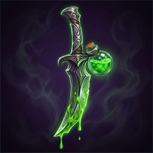

*Never fight with a dry blade again.*

When a weapon has no poison, Rogue Poison shows a bar at the top of the screen with the weapon and the poisons in your bags. Click a poison and it goes on that weapon. No dragging poisons onto the character sheet, no macros to write.

## At a glance

- **One row per weapon:** main hand and off hand each get their own row, so a click always coats the right one.
- **Your poisons, ready to click:** every rank of Instant, Deadly, Wound, Crippling, Mind-numbing and Occult Poison, plus Sebacious, Numbing and Atrophic Poison, with how many you carry.
- **Stays out of the way:** the bar only shows when a weapon needs poison, and hides in combat.
- **Works with [Rogue WeaponSwap](https://www.curseforge.com/wow/addons/rogue-weaponswap):** it also watches the dagger or sword waiting in your bags. Poison it there and it comes out poisoned at the next swap.
- **Tooltips:** hover a poison or the weapon icon for its tooltip.

## Getting started

Install and log in. That is all: there is nothing to set up. The bar appears on its own when a weapon you hold has no poison, from level 20 or as soon as you carry a poison.

## Slash commands

- `/rpoison`: say which weapons have a poison
- `/rpoison test`: show the bar on poisoned weapons too, to see it or replace a poison
- `/rpoison debug`: turn the debug log on or off

## FAQ

**Why does the bar disappear in combat?**
The game does not let an addon show, hide or change click buttons in combat. The bar hides when a fight starts and comes back when it ends.

**Can I use it without WeaponSwap?**
Yes. Without it, Rogue Poison watches your main hand and off hand only.

**Something went wrong. What do I send?**
Type `/rpoison debug`, reproduce the problem and `/reload`. Then attach `WTF\Account\<account>\<realm>\<character>\SavedVariables\RoguePoison.lua` to an issue on GitHub, or paste it in the comments.

## Supported versions

WoW Forever (1.60.1). Other Classic clients are untested.

## Feedback and source

Bug reports, ideas and source code: [github.com/RafaelHGOliveira/RoguePoison](https://github.com/RafaelHGOliveira/RoguePoison). MIT license.
